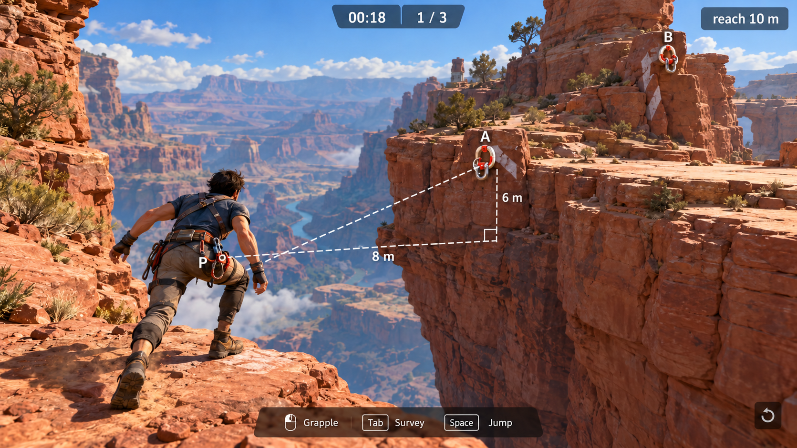
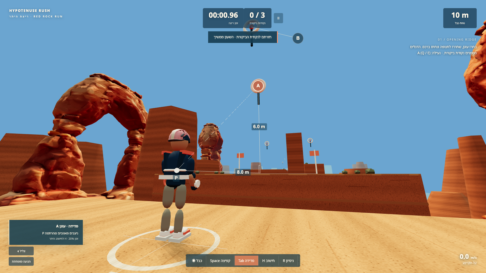
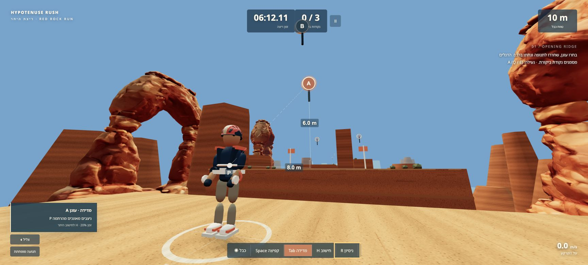

# Target and playable production review

The [generated gameplay target](visual-targets/gameplay-v1.png) is a design reference, **not an implementation capture**. The target and exact prompts were inspected with `view_image`. The two already-submitted normal Tripo generations were retained after this target arrived; no third generation or replacement provider was used.

The comparable actual production capture is [opening survey](evidence/survey-opening.png), 1672×941; the generated reference is 1671×941. The actual state is at the marked harness stance after a B overreach and local retry: A has `(8,6,0) m`, B has `(6,9,0) m`, reach is 10 m, no hook is attached, and survey is active without H calculation. The exact [state file](evidence/survey-opening.json) records the current harness, camera and assistance state.

## Breakdown and comparison

| Aspect | Target | Actual implementation / evidence | Difference or fix |
|---|---|---|---|
| Camera and framing | Low behind-left chase; large full-body athlete, gap and landing readable | Close 2.9 m chase with lateral framing; high-anchor selection widens the camera so the hook stays visible. Initial far-view captures were still in the title transition and are not the final comparison | Full-body framing achieved after settling; dynamic B framing is deliberately wider. The body remains less detailed than the reference |
| Canyon / depth | Rugged layered sandstone, distant canyon strata, open cobalt sky | Original textured Tripo arch and repeated canyon art; warm light, local rock grain, distance haze, broad exact ledges | Main platforms and cliff columns remain visibly rectilinear. Sky and vegetation are much simpler than the target |
| Athlete / silhouette | Athletic human, navy shirt, tan trousers, coral harness equipment | Navy/tan articulated human with coral shoulder/hip gear; separate hips, torso, arms, elbows, legs and knees; original generated coral/ivory helmet | Target has uncovered hair. The retained helmet is an intentional equipment difference. Body anatomy, cloth and foot contact remain stylized; no generated rig or inverse kinematics is claimed |
| Measurement origin | P at the actual harness; perpendicular 8 m and 6 m legs and a dashed direct line | Root-fixed P marker at feet +1.05 m, independent of torso lean/bob; exact authored anchors and world-axis guides; no automatic solved diagonal | Perspective is illustrative, never a ruler. Tripo meshes supply no measurement or collider authority |
| HUD hierarchy | World dominates; timer/checkpoint centered, reach separated, slim action hints | Sparse centered timer/checkpoint, isolated reach, functional grapple/jump/survey/hint/retry strip, small route text | Early offscreen mute/motion settings caused a cyan overflow strip; settings were moved out of the transformed bar. Real Chrome proof has no strip. The final [QA opening capture](evidence/qa-opening-survey.png) verifies the B badge moved clear of the timer with a thin leader, without moving the anchor or changing reach |
| Typography / RTL | Minimal Hebrew requested; selected target contains an English reach caption | Default Hebrew UI, bundled Hebrew font, isolated LTR quantities; actual formula and survey overlays inspected | Actual checkpoint is correctly 0/3 at the first stance, rather than copying the target’s premature 1/3. Hebrew טווח כבל replaces English reach. H equations are optional and separated |
| Inputs | Grapple, jump, Tab survey and replay visible | Keyboard/mouse plus touch controls; pause, retry, restart, sound and reduced motion tested by the crew | Real Chrome input proof below supplements deterministic/action-client checks; controls are not part of the reference bitmap |
| Action and feedback | Poised launch with a readable cable and meaningful landing | [Actual A grapple](evidence/grapple-A.png) shows airborne articulated reach and cable; [overreach](evidence/overreach.png) distinguishes short reach; local retry, release momentum and safe landing were observed | No claim that automation proves enjoyment or learning. Procedural poses communicate movement, with simpler anatomy/foot planting than the target |
| Course consequence | A meaningful traverse, not a model viewer | Nine actual grapples, three ordered checkpoints and [finish](evidence/finish.png); full-route state in [browser results](evidence/browser-results.json) | The documented complete route took 51.69 simulation seconds with assistance, 0 falls and 9 releases. It is a test witness, not a human skill or fun score |

## Models and processing

[ASSETS.md](../ASSETS.md) preserves exact normal UI prompts, task IDs, displayed cost, source/processed hashes, processing commands and licensing notes. Both generated models are used in actual gameplay. They have no skins or motion clips; body animation comes from the procedural joints.

- Sandstone arch: 1,897,224 bytes, 37,198 triangles, three embedded 1024×1024 JPEG maps.
- Runner helmet: 642,388 bytes, 6,956 triangles, three embedded 1024×1024 JPEG maps.
- Both final GLBs have indices, UVs and sampled finite unit normals; no external URI or required decoder extension. Base color, normal and metallic-roughness JPEG bytes and role bindings match the original exports exactly. `tools/inspect-glb.py` passed; [inspection output](ASSET_INSPECTION.json) is saved.

## Real user Chrome review

[Actual Chrome screenshot](evidence/chrome-gameplay.jpg) and [record](evidence/chrome-gameplay.json) were captured in a dedicated new Chrome tab named **🏜️ Hypotenuse Rush Play**, using the existing user browser at `http://localhost:4183/`. Viewport 1728×780, DPR 2. This page stayed on build `JKeBorHy` while the later B badge leader build was prepared; it was not refreshed mid-play.

Normal UI/pointer/keyboard input verified start, B overreach (10.81665 m against 10 m), retry, W movement and the changed harness distance, A hold/release, articulated airborne motion, safe landing, pause/resume, and Tab survey. No `advanceTime` or win-state injection was used. The released velocity was approximately `(15.303,9.477,0) m/s`. The landing was on the broad ledge at `(26.2144,1.002,0) m`; this partial attempt overshot the checkpoint gate in air, so it does **not** claim a completed checkpoint or route. The separate crew full-route proof covers ordered checkpoints and finish.

Both local model flags were true, and the arch and helmet were visually present. No game-origin console error was observed. One unrelated browser extension component-inspection error was recorded separately. The Chrome run clock includes lengthy inspection idle periods and is not a course-time benchmark. Loaded-host wall-frame samples are recorded as such, without claiming a general FPS result. The play tab was closed after capture to release resources; the verified production server remains available.

## Follow-up fixes verified separately from the original Chrome run

The original real Chrome attempt safely landed beyond the narrow first gate, at x=26.2144 m, while its checkpoint stayed at 0. That observation and original state remain intact. The lead subsequently broadened the **painted physical landing checkpoint zones** to `[c.x-2.5, c.x+8]`, retaining grounded contact, the correct height, lateral bounds and checkpoint order. This changes landing forgiveness, not grapple reach or the triangle witnesses.

Independent QA confirmed the new 0.75-second-hold trajectory regression and the final production landing behavior. The [fresh QA landing capture](evidence/qa-landing.png) and [state](evidence/qa-landing.json) show the grounded athlete at `(24.1811,1.002,0) m` with checkpoint 1 saved. This later verification does not rewrite the original Chrome attempt.

Final independent QA passed **11 groups with zero application errors**, including the in-range D obstruction, pause/retry/survey timing, phone layout, B badge leader, camera/resize preservation and touch multi-pointer release. [Results](evidence/qa-results.json). The [1280×720 QA opening](evidence/qa-opening-survey.png) confirms the badge/leader fix; the [390×844 phone capture](evidence/qa-phone-opening.png) confirms in-viewport controls and a B badge below the timer. Phone help overlays cover part of the scene, as the capture shows.

## Remaining fidelity limits

The implementation matches the reference’s genre, core view, action, warm sandstone palette, navy/tan/coral silhouette, current-origin survey and HUD hierarchy. It remains a stylized prototype: clean authored platform edges and cliff columns, simple blue sky, sparse vegetation, a procedural human body, and no skeletal animation or foot IK. Those gaps are visible in the actual captures and are not hidden behind the generated reference. Static visual similarity does not establish functional parity, enjoyment or learning gains.

## Final performance and input checks

The final full route was recaptured on the final build after the painted landing-zone and badge fixes: **51.6883 simulation seconds, nine grabs/releases, three ordered checkpoints, zero falls and zero game errors**. The final independent suite passes 11 groups, including the in-range D obstruction and portrait phone controls. See [QA results](evidence/qa-results.json) and [portrait capture](evidence/qa-phone-opening.png).

The retina canvas cap was reduced from 1.7 to 1 after the original user-Chrome observation showed poor frame intervals on the loaded shared host. The final [real-time performance sample](evidence/performance.json) used installed Chrome with Metal on Apple M2 Max, a 1728×780 viewport, display DPR 2 and measured canvas ratio 1. Across the final 240 rolling render intervals, mean was 33.3321 ms and P95 was 33.4 ms, approximately 30 Hz at the configured cap. It used normal real-time input and did not invoke `advanceTime`. These are measurements of this environment, not a guarantee for every device or browser session.
